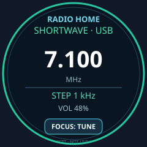
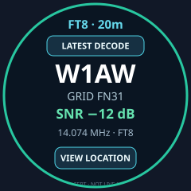
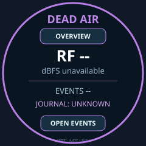
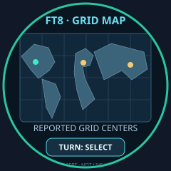
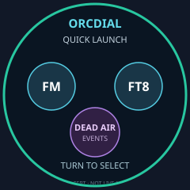
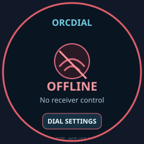

# OrcDial 2.0 — 240x240 design gallery

**Static, editable SVG concepts; NOT M5GFX screenshots or real decoder/radio data.** Each SVG is exactly 240x240 in the source viewBox and contains an explicit concept disclaimer. These visuals are meant to settle information hierarchy and input gestures before implementing any embedded drawing code.

| Radio Home (instrument) | FT8 latest decode | Dead Air overview |
|---|---|---|
|  |  |  |

| FT8 locator map | Quick launcher | Offline recovery |
|---|---|---|
|  |  |  |

## Review questions

1. At 240px 1:1, can you read callsign, frequency and chosen action quickly without zooming?
2. Should the Dial automatically show latest FT8 decode, or only on the dedicated FT8 view?
3. Do we want a world map at this size, or does a grid bearing/distance compass convey more useful detail? A map is a *plot of decoded grid-area centers*, never an exact transmitter location.
4. What gesture opens launcher without breaking existing long-hold-to-Home and four-second settings hold?
5. What Dead Air action is most important to reach with the knob? We propose an explicit Mark Event action on Events, not a global hidden button.
6. Does the red ring adequately communicate offline? Should stale link/data use amber instead?

## Evidence limitations

All displayed stations, frequencies, map markers and operational labels are illustrative, not observations. None of these files tests M5GFX rendering, embedded memory usage, touch hitboxes, accessibility, hardware display contrast or actual RF reception. Hardware capture and native output tests are phase-gated in [the roadmap](../IMPLEMENTATION_ROADMAP.md).
